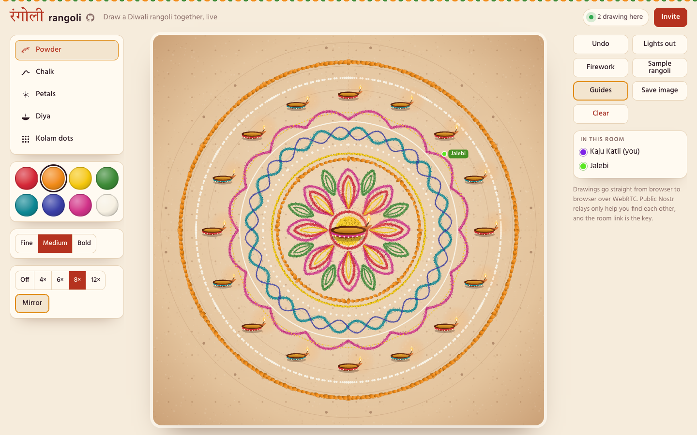
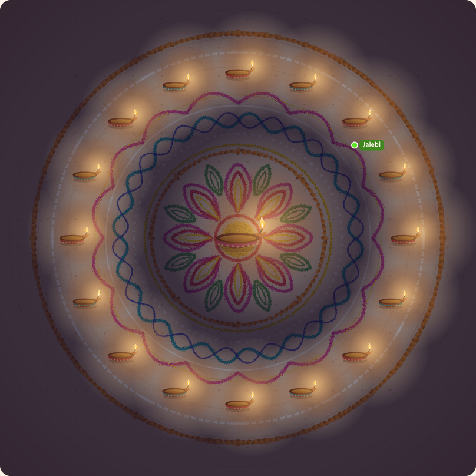
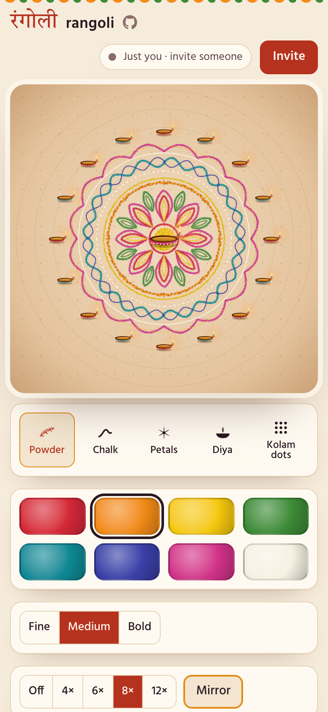

# rangoli · रंगोली

[](https://samarthjaiswal.github.io/rangoli/)
[](https://github.com/SAMARTHJAISWAL/rangoli/actions/workflows/ci.yml)

A rangoli board you share with a link. Everyone who opens the link draws on the same board in real time: powder colours, chalk lines, marigold petals, kolam dots and clay diyas, with every stroke repeated around the centre in 4-, 6-, 8- or 12-fold symmetry. Press **Lights out** and the board goes dark for everyone, leaving the diyas to light the colours around them.

There is no server. Browsers connect to each other directly over WebRTC, and a small CRDT (a conflict-free replicated data type) makes sure everyone ends up with exactly the same picture, whatever order the strokes arrive in.

**[Open a board →](https://samarthjaiswal.github.io/rangoli/)** then press **Invite** and send the link to someone.


<sub>Two tabs in one room. The left one draws; everything on the right arrived by syncing, live strokes included.</sub>



## What you can do

- **Draw with five brushes.** *Powder* lays down a grainy line of coloured powder, and *chalk* a crisp line. *Petals* stamps marigold petals along the path. *Kolam dots* places evenly spaced dots, and *diya* sets down clay lamps with flickering flames.
- **Pick from eight colours** named after what rangoli powder is made from: sindoor, marigold, haldi, mehendi, peacock, neel, rani and chalk.
- **Draw symmetrically.** Each stroke is repeated 4, 6, 8 or 12 times around the centre, optionally mirrored, so one line becomes a full ring. Lamps are the exception: they always stand upright, and only their positions follow the symmetry. With a mouse, faint markers show where every copy of your cursor will land.
- **Draw together.** Strokes appear on everyone's screen while they are being drawn. You can see everyone's cursor with a festive name (Kaju Katli, Jalebi, Phuljhadi and so on), and a counter shows how many people are in the room.
- **Shared actions:**
  - **Lights out** darkens the board for everyone, with each lamp lighting the colours around it.
  - **Firework** sets off a burst that everyone sees, identical on every screen.
  - **Sample rangoli** adds a finished eight-fold design to draw around.
  - **Clear** erases the board for everyone, after asking.
- **Keep your work.** Undo removes your own last stroke, never someone else's. The board is saved in your browser, so a reload brings it back, and **Save image** downloads a PNG.
- **Use it anywhere.** It works with a phone, a pen or a mouse; the page follows your light or dark theme.

Keyboard: <kbd>1</kbd>–<kbd>5</kbd> brushes, <kbd>M</kbd> mirror, <kbd>N</kbd> lights, <kbd>F</kbd> firework, <kbd>G</kbd> guides, <kbd>Ctrl</kbd>+<kbd>Z</kbd> undo.

<p align="center"> </p>

## How it works

### Finding each other without a server

A room is a random id in the URL fragment (`#k3x9…`), which browsers never send to any server. Peers find each other with [trystero](https://github.com/dmotz/trystero), which posts WebRTC connection offers on public [Nostr](https://nostr.com) relays under a topic derived from the room id. The offers are encrypted with the room id as the key, so the relays can't read them. Once two browsers have exchanged offers, they talk directly over a WebRTC data channel, and every stroke goes browser to browser. Tabs of the same browser also talk over a `BroadcastChannel`, which works offline too.

### One picture for everyone: the CRDT

The board is a set of immutable **operations**, each made by one author:

| Operation | Meaning |
| --- | --- |
| `s` stroke | brush, colour, size, symmetry and a list of points |
| `e` erase | remove these stroke ids |
| `n` night | lights out or on |

Every operation carries its author's id, a per-author sequence number (1, 2, 3, …) and a [Lamport timestamp](https://lamport.azurewebsites.net/pubs/time-clocks.pdf). The rules are chosen so that applying operations is idempotent and commutative:

- **Strokes** form a set.
- **Erasures** form a second set of removed ids. A removed id stays removed even if its erasure arrives before the stroke itself (*remove wins*).
- **Drawing order** is a total order: Lamport time, then author id, then sequence number. Every peer computes it the same way, so the layering is identical everywhere.
- **Night mode** is a last-writer-wins register under that same order.

So two peers that have received the same operations show the same board, in any arrival order and with any number of duplicates. Undo and clear are erase operations too. If you clear the board while someone else is mid-stroke, their stroke survives, because your clear only names the strokes you could see.

### Keeping everyone in sync

Sync is **state-vector anti-entropy**:

- **Joining:** when two peers meet, each sends the highest contiguous sequence number it holds from every author. The other answers with every operation above those numbers, in messages split by both count and size.
- **Drawing:** new operations are pushed to everyone at once.
- **Repair:** every few seconds each peer swaps state vectors with one random peer, which fills in anything lost on the way.

Strokes in progress are sent separately, as small batches of new points every 45 ms. They are previews only, never stored, and they disappear when the finished stroke arrives.

### Rendering the same pixels everywhere

Rendering is plain Canvas 2D, in two layers:

- **Base layer:** the floor and every finished stroke. It is redrawn only when the picture changes, and a stroke that sorts last is simply painted on top.
- **Effects layer:** redrawn every frame. It holds strokes in progress, the night shading, flames, fireworks and other people's cursors.

Symmetry uses canvas rotations: a stroke's geometry is computed once and drawn under each rotation and mirror.

All randomness is seeded from the stroke's id: where each powder grain lands, how each petal tilts, how each flame flickers. So a stroke looks the same on every screen. It also looks the same whether you watched it being drawn or received it finished, and a test checks that for every brush.

Night mode draws a dark layer and cuts a soft pool of light out of it around each flame. That is why the lamps light the rangoli near them instead of washing over the whole board.

### Untrusted input

Everything that arrives from another browser is validated before use (`src/core/wire.ts`):

- **Fresh objects:** each message becomes a fresh object containing only known fields.
- **Allow-lists:** ids, brushes, colours and symmetries must come from fixed lists.
- **Points:** coordinates must be integers on the board.
- **Size limits:** a stroke has at most 2,000 points and a path length of at most six board widths. An erase names at most 5,000 strokes, and an author may make at most 20,000 operations.
- **Clock cap:** Lamport times are capped at 2^40, and a local clock *saturates* at that cap instead of overflowing. Otherwise one peer that sent a huge timestamp could make everyone else's later operations invalid.

Every limit is a property of a single operation, never of the document as a whole, so every peer accepts or rejects the same operation the same way. On top of that:

- **Bounded rendering:** stroke geometry has a hard size bound, and the geometry cache has a memory budget.
- **Bounded previews:** live previews, cursors and fireworks are capped, and requests to resend the board are rate-limited per peer.
- **No HTML from peers:** names are shown with `textContent` or drawn on the canvas, never parsed as HTML.

## Testing

`npm test` runs 44 tests in under a second:

- **CRDT properties.** For 200 random histories by three authors, applying the operations in six different shuffled orders, with duplicates, always gives the same picture. Other tests cover erasures that arrive before their stroke, a clear racing a stroke, last-writer-wins night mode and gap tracking.
- **Sync under faults.** An in-memory network delivers messages through JSON with random delays, 10% loss and 5% duplication. It can cut and restore links between peers.
  - **Random fault runs:** 300 seeds, each with 2 to 5 peers. Each run makes 80 random drawings, undos, clears, light toggles, partitions and heals.
  - **Check:** after healing, every peer's board must equal a reference built from all the operations. `SYNC_SEEDS=3000` runs ten times as many in about 3 seconds.
  - **Other cases:** a late joiner and a 1,000-stroke backlog.
- **Hostile input.** Malformed operations, prototype-pollution attempts (`__proto__` keys), oversized messages, a peer that pushes the Lamport clock to its cap, a stroke that zig-zags to maximise its cost, and a flood of resend requests.
- **Rendering.** For each brush, a stroke that grew point by point produces exactly the same geometry as the same stroke received finished.

`scripts/e2e.py` (Python Playwright) checks 41 things in real browsers:

- **Two tabs in one room:** presence, cursors and live previews, then brushes, colours and symmetry carried with each stroke. Also undo ownership, lights out, fireworks and the sample rangoli. It ends with a late joiner, a reload restoring the board, clear, save image and a tab leaving.
- **Two separate browser contexts** that can reach each other only over WebRTC through the public relays: they connect (typically in under 2 seconds), and strokes, the sample and lights out all cross the network.
- **The page itself:** the room link, the welcome dialog, the title linking to this repo, and on a phone, no sideways scrolling, buttons big enough to tap, and drawing by tap.

## Limitations

- **No TURN server.** WebRTC needs a direct path between the two browsers. It uses public STUN servers to find one, which works on most home and mobile networks. Some corporate or symmetric-NAT networks block every direct path; then the two browsers simply never connect, and each keeps its own board.
- **Public relays.** Finding each other depends on the public Nostr relays being up. trystero uses several at once, so one or two being down doesn't matter.
- **Authors are not authenticated.** Anyone with the room link is trusted to draw. A malicious peer could forge operations under someone else's author id, for example erasing their next strokes. Fixing that needs a signing key per author. For now the room link is the key, so share it with people you'd hand a box of rangoli colours.
- **The board lives in the room.** It is saved in each visitor's browser, and anyone who opens the link gets it from whoever is online. If nobody who has the board is online, a newcomer sees an empty board. Use **Save image** to keep a copy.

## Project layout

```
src/
  core/             no DOM: the shared model
    types.ts          operations, palette, limits
    doc.ts            the CRDT: apply, order, state vectors, fingerprint
    sync.ts           anti-entropy sync engine over any transport
    wire.ts           validation of everything that arrives from a peer
    symmetry.ts       rotations and mirrors about the centre
    pattern.ts        the sample rangoli, built from ordinary strokes
    rng.ts, names.ts
  net/
    p2p.ts            WebRTC through trystero and Nostr relays
    tabs.ts           BroadcastChannel between tabs, with heartbeats
  render/
    brushes.ts        powder, chalk, petals, dots, diyas; seeded geometry cache
    board.ts          base and effects layers, night lighting, cursors
    fireworks.ts      seeded, closed-form firework bursts
  ui/                 the controller and the brush icons
tests/              Vitest: CRDT, sync under faults, wire validation, symmetry, review regressions
scripts/            e2e.py, capture.py and record_gif.py (Python Playwright)
```

The production bundle is about 113 KB of JavaScript (40 KB gzipped) and 9 KB of CSS, plus the Hind and Tiro Devanagari Hindi fonts, bundled through Fontsource.

## Running locally

Requires Node 22.12 or later.

```sh
npm ci
npm run dev          # http://localhost:5173
npm test
npm run typecheck
npm run build        # dist/, served from /
npm run build:pages  # dist/, served from /rangoli/ (what GitHub Pages gets)
```

Add `?net=local` to the URL to sync only between tabs of one browser, without touching the network.

End-to-end checks, screenshots and the GIF use Python Playwright (`pip install playwright pillow && playwright install chromium`):

```sh
npm run build && npx vite preview --port 4173 &
python scripts/e2e.py http://localhost:4173/
python scripts/capture.py http://localhost:4173/
python scripts/record_gif.py http://localhost:4173/
```

Pushing to `main` runs CI (typecheck, tests, both builds) and deploys to GitHub Pages.

## References

- Leslie Lamport. [Time, Clocks, and the Ordering of Events in a Distributed System](https://lamport.azurewebsites.net/pubs/time-clocks.pdf). Communications of the ACM, 1978.
- Marc Shapiro, Nuno Preguiça, Carlos Baquero and Marek Zawirski. [Conflict-free Replicated Data Types](https://inria.hal.science/inria-00609399). SSS 2011.
- Alan Demers et al. Epidemic Algorithms for Replicated Database Maintenance. PODC 1987 (anti-entropy).
- [trystero](https://github.com/dmotz/trystero): serverless WebRTC matchmaking over Nostr, BitTorrent, MQTT and others.

## Licence

[MIT](LICENSE) © 2026 Samarth Jaiswal
